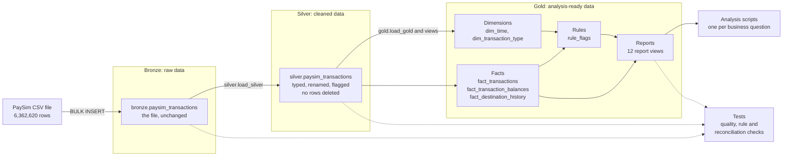
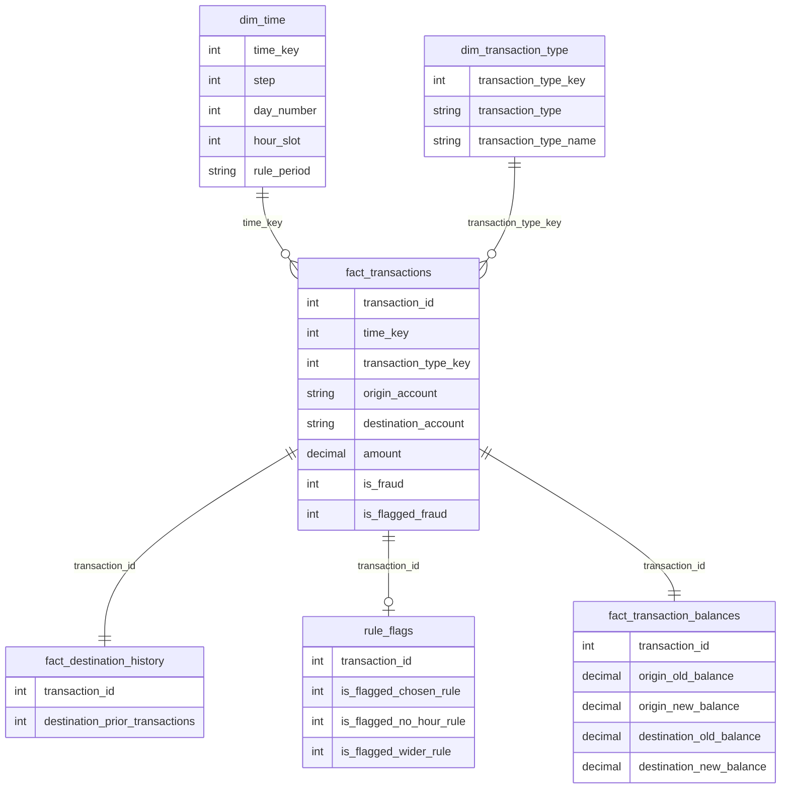

# PaySim Fraud Analysis

An end-to-end SQL project on the PaySim synthetic mobile money dataset (6.36 million
transactions). It loads the raw file into a SQL Server data warehouse, measures how badly the
existing fraud rule performs, and designs and tests a better one, all in SQL.

On test days it had never seen, the new rule caught 47.7% of fraud while flagging 0.45% of
honest transfers and cash-outs. The existing rule caught 0.25%.

PaySim is synthetic data. Every result here describes a simulation, not real customers.

---
## Business Question

The company's current fraud rule catches almost none of the fraud. Where does fraud happen,
what does it look like, and can a better SQL-based rule catch more of it without flagging too
many honest customers?

That question is broken into ten smaller ones. Each is answered by one script, and the
written answers are in [docs/findings.md](docs/findings.md).

| # | Question | Script |
|---|---|---|
| 1 | How big is the fraud problem, in transactions and in money? | [01_fraud_overview.sql](scripts/analysis/01_fraud_overview.sql) |
| 2 | Which transaction types does fraud happen in? | [02_fraud_by_type.sql](scripts/analysis/02_fraud_by_type.sql) |
| 3 | On which days does fraud happen, and how does it compare with normal volume? | [03_fraud_by_day.sql](scripts/analysis/03_fraud_by_day.sql) |
| 4 | At what time of day is fraud most concentrated? | [04_fraud_by_hour.sql](scripts/analysis/04_fraud_by_hour.sql) |
| 5 | What amounts does fraud use, compared with normal transactions? | [05_fraud_by_amount.sql](scripts/analysis/05_fraud_by_amount.sql) |
| 6 | Where does the fraud money go: repeated destination accounts, merchants? | [06_fraud_destinations.sql](scripts/analysis/06_fraud_destinations.sql) |
| 7 | How badly does the existing rule perform? | [07_existing_rule_performance.sql](scripts/analysis/07_existing_rule_performance.sql) |
| 8 | What does the fraud that the existing rule misses look like? | [08_missed_fraud.sql](scripts/analysis/08_missed_fraud.sql) |
| 9 | Within the types where fraud happens, which signals separate fraud from normal? | [09_fraud_signals_build_period.sql](scripts/analysis/09_fraud_signals_build_period.sql) |
| 10 | Can a better SQL rule catch more fraud without flagging too many honest customers? | [10_better_rule.sql](scripts/analysis/10_better_rule.sql) |

---
## Headline Results

All figures come from queries in this repository and describe synthetic data.

**Where fraud is**

- 8,213 of 6,362,620 transactions are fraud. That is 0.1291% of transactions but 1.0535% of
  the money.
- Fraud happens in two transaction types only: CASH_OUT (4,116) and TRANSFER (4,097). The
  other three types have none.
- The amount of fraud is steady from day to day and hour to hour. Normal activity is not, so
  the fraud rate is far higher on quiet days and in quiet hours.
- Almost every fraud transfer goes to a destination account that has never received anything
  before.

**The existing rule**

- It flags 16 transactions in the whole month. All 16 are fraud, and it misses the other
  8,197.

**The new rules, on build and test**

The rules were designed on days 1 to 15 (build) and scored once on days 16 to 30 (test).
Scores cover TRANSFER and CASH_OUT transactions only. The fraud rate is 0.1774% in the build
period and 0.7767% in the test period.

| Rule | Period | Flagged | Fraud caught | Honest flagged | Precision | Recall | False positive rate |
|---|---|---:|---:|---:|---:|---:|---:|
| Existing flag | Build | 3 | 3 | 0 | 100.00% | 0.07% | 0.000% |
| Existing flag | Test | 10 | 10 | 0 | 100.00% | 0.25% | 0.000% |
| Chosen rule | Build | 10,758 | 1,748 | 9,010 | 16.25% | 43.52% | 0.399% |
| Chosen rule | Test | 4,148 | 1,872 | 2,276 | 45.13% | 47.71% | 0.454% |
| No-hour rule | Build | 10,377 | 1,235 | 9,142 | 11.90% | 30.74% | 0.404% |
| No-hour rule | Test | 3,151 | 1,279 | 1,872 | 40.59% | 32.59% | 0.373% |
| Wider rule (outside the cap) | Build | 70,462 | 3,130 | 67,332 | 4.44% | 77.92% | 2.978% |
| Wider rule (outside the cap) | Test | 18,109 | 3,143 | 14,966 | 17.36% | 80.10% | 2.985% |

How to read the table:

- **Recall** is the share of fraud a rule caught. **False positive rate** is the share of
  honest transactions it flagged. These two do not depend on how common fraud is, so they are
  the fair comparison between the two periods. Both held steady from build to test.
- **Precision** is the share of flagged transactions that are fraud. It rose on the test
  period only because fraud is more than four times as common there. The rules did not become
  more accurate.
- **The chosen rule** stayed within its limit of flagging no more than 0.5% of honest
  transactions, on both periods.
- **The no-hour rule is the more realistic figure.** It caught 32.59% of test-period fraud
  without using the hour of the day. The hour signal is probably an artifact of the
  simulation, as explained below.
- **The wider rule** is outside the limit on purpose. It shows what flagging about 3% of
  honest customers would buy.

The three rules, in words:

- **Chosen rule:** flag a CASH_OUT of 800,000 or more, or of zero, or in hour slots 0 to 6.
  Flag a TRANSFER to a new destination that is in hour slots 0 to 6 or is 5,000,000 or more.
- **No-hour rule:** flag a CASH_OUT of 800,000 or more, or of zero. Flag a TRANSFER to a new
  destination of 1,500,000 or more.
- **Wider rule:** flag a CASH_OUT of 800,000 or more, or of zero, or in hour slots 0 to 7.
  Flag any TRANSFER to a new destination.

A "new destination" is an account that received no transaction in any earlier hour.

---
## Limits of Synthetic Data

- **The data is simulated.** The rules describe how PaySim generates fraud. Real fraud will
  differ.
- **The hour signal is probably an artifact.** PaySim spreads fraud evenly across the day
  while normal activity follows a daily rhythm. Real fraud is unlikely to be spread that
  evenly, so a rule built on the hour would likely work much less well on real data. The data
  also does not say which clock hour slot 0 is.
- **One month only.** "New destination" is measured inside a single month. With a longer
  history, fewer honest destinations would look new.
- **Build and test come from the same simulated month.** The test shows the rules were not
  fitted to noise. It does not show they would survive a change in how fraud behaves.
- **More than half of the fraud is still missed** at a 0.5% false positive rate.

---
## Data Architecture

The warehouse follows the Medallion Architecture, with **Bronze**, **Silver** and **Gold**
layers:



1. **Bronze Layer**: Stores the source file as it is. One table with the same 11 columns, in
   the same order, with the same names. Nothing is cleaned.
2. **Silver Layer**: Holds the same rows with readable column names, exact money types, a day
   and an hour derived from the step, and a transaction id. Problem rows are flagged, not
   deleted.
3. **Gold Layer**: Holds a small star schema, the detection rules, and one report view for
   each analysis question.

### Why medallion with one source

Medallion architecture is usually used to combine several source systems. This project has
one CSV file, so the layers are not about combining sources. They separate three different
jobs:

1. **Bronze keeps the untouched original**, so any number can be traced back to the file.
2. **Silver is where every cleaning decision lives**, so each one can be read and checked in
   one place.
3. **Gold is the model the analysis runs on**, so no report has to repeat the cleaning.

That traceability paid off during the project. A check on the balance columns gave wrong
counts at first, and having the raw values in bronze, next to the cleaned values in silver,
is what made the cause easy to find (see "Problems Solved Along the Way").

---
## Data Model



Two design choices are worth explaining:

- **The balance columns are kept out of the main fact.** The dataset's author notes that
  detected fraud transactions are cancelled, so the balance columns give the outcome away. In
  this data, the amount equals the whole origin balance in 8,034 of the 8,213 fraud
  transactions and in none of the honest ones. A rule using that would look excellent and
  would be cheating. So `fact_transactions`, which rules are written against, has no balance
  columns. They live in `fact_transaction_balances`, for description only.
- **The dimensions and the destination history are tables, not views.** The reference project
  builds every gold object as a view. Here, in a one-off timing test, a report that had to
  rebuild both dimensions from silver on every query took 18.6 seconds, against 5.5 seconds
  with the dimensions stored. The fact itself stays a view, so there is no second copy of the
  transactions.

Every column is described in [docs/data_catalog.md](docs/data_catalog.md).

---
## How the Rule Was Built

The aim was a result that can be trusted, so the method was fixed before the results were
seen.

1. **The selection criterion came first.** Before any rule was scored, the criterion was set:
   catch as much fraud as possible while flagging no more than 0.5% of honest TRANSFER and
   CASH_OUT transactions, and prefer the simpler rule when two are within one point of recall.
2. **The data was split by day.** Rules were designed on days 1 to 15 and tested on
   days 16 to 30. The first plan was days 1 to 20 and 21 to 31, but profiling showed normal
   volume collapses from day 18 onward, which would have left a test period made only of
   quiet days. Moving the cutoff put two busy days in the test period and split the fraud
   almost evenly.
3. **Day 31 was left out of scoring.** It has 272 fraud transactions and no normal ones, which
   is an artifact of the simulation. It stays in the data.
4. **Rules may only use what was known at the time.** A rule can use the transaction's own
   type, amount and hour, and the destination's history from earlier hours. It cannot use the
   balance columns, the fraud label, or anything from the same hour or later.
5. **The rules were frozen before the test.** The three rules were written down and committed
   (git tag `rules-frozen`), and only then scored on the test period, once. No rule was changed
   afterwards.
6. **Rules are judged on precision, recall and false positive rate together**, never on
   accuracy. With fraud at about 1 transaction in 800, a rule that flags nothing is 99.87%
   accurate.

The full account, including every candidate rule that was tried, is in
[docs/findings.md](docs/findings.md), question 10.

---
## Problems Solved Along the Way

- **The row terminator.** The first load failed with "the column is too long in the data file
  for row 1, column 11", which reads like a column sizing problem. The real cause was that the
  CSV uses LF line endings and `BULK INSERT` expects CRLF. Writing `'\n'` does not fix it,
  because `BULK INSERT` quietly turns that back into CRLF. The fix is the hex form,
  `ROWTERMINATOR = '0x0a'`. See [docs/row_terminator_note.md](docs/row_terminator_note.md).
- **MAXERRORS.** About 4.1% of rows write their amounts in scientific notation, which
  `BULK INSERT` cannot load into a `DECIMAL` column. By default it skips up to 10 failing rows
  and still reports success, so a test load of 5 rows loaded 3 with no error. The bronze load
  now uses `FLOAT` columns and sets `MAXERRORS = 0`, so a partial load can never pass
  silently. See [docs/maxerrors_note.md](docs/maxerrors_note.md).
- **The FLOAT comparison.** The first check of whether balances add up compared `FLOAT`
  values against a 0.01 tolerance. Many rows are off by exactly one cent, and `FLOAT` cannot
  hold 0.01 exactly, so those rows fell on either side of the line and the counts were wrong.
  For one transaction type the first check reported 7.22% of rows, and the correct count is
  33 rows. The checks now cast every value to `DECIMAL(18,2)` before comparing. See
  [docs/data_profiling_note.md](docs/data_profiling_note.md).
- **The memory stall.** The first full load stalled because the laptop was short of memory.
  SQL Server's wait statistics pointed to the cause. `BATCHSIZE` was added to the bronze load
  so it commits in batches, and freeing memory on the machine fixed the rest.

---
## How to Run It

### What you need

- **SQL Server.** The project was built on SQL Server 2025 Express.
- **sqlcmd**, or SQL Server Management Studio (SSMS) with SQLCMD Mode turned on.
- **The dataset.** Download the CSV from Kaggle and place it in the `datasets` folder. See
  [datasets/README.md](datasets/README.md).

### Before the first run

The full path to the CSV file is written into two scripts. Change it in both to match where
the file is on your machine:

- `scripts/bronze/proc_load_bronze.sql`
- `tests/reconciliation_checks.sql`

### Run everything

From the project's root folder:

```
sqlcmd -S localhost\SQLEXPRESS -E -C -d master -i scripts\run_all.sql
```

`scripts/run_all.sql` rebuilds the whole project from the CSV and reruns every test and every
analysis script. It uses the sqlcmd include command, so it only works with sqlcmd or with SSMS
in SQLCMD Mode.

Things to know:

- **It drops the `PaysimFraudAnalysis` database first**, if it exists.
- **`-C` trusts the local server certificate.** Without it, recent ODBC drivers refuse to
  connect to a local instance that uses a self-signed certificate.
- **It needs free memory.** Close other applications before running it. The silver load sorts
  all 6.36 million rows.

### Or run the steps one at a time

1. `scripts/init_database.sql`
2. `scripts/bronze/ddl_bronze.sql`, then `scripts/bronze/proc_load_bronze.sql`, then
   `EXEC bronze.load_bronze;`
3. `scripts/silver/ddl_silver.sql`, then `scripts/silver/proc_load_silver.sql`, then
   `EXEC silver.load_silver;`
4. `scripts/gold/ddl_gold.sql`, then `scripts/gold/proc_load_gold.sql`, then
   `EXEC gold.load_gold;`
5. The scripts in `tests/`
6. `scripts/bronze/profile_bronze.sql` and the scripts in `scripts/analysis/`, in number order

Running `scripts/gold/ddl_gold.sql` again drops the gold tables, so always follow it with
`EXEC gold.load_gold;`.

---
## Tests

| Script | What it proves |
|---|---|
| [tests/quality_checks_silver.sql](tests/quality_checks_silver.sql) | Silver has every bronze row, unique ids with no gaps, no NULLs, matching money totals, and flags that hold what they should. |
| [tests/quality_checks_gold.sql](tests/quality_checks_gold.sql) | The dimensions have unique keys, every fact row matches a dimension row, the fact exposes no balance column, and every report adds up to the same totals. |
| [tests/rule_checks.sql](tests/rule_checks.sql) | The rule view reads no balance column and no fraud label. The flags equal the rules as written in plain English, when worked out again from scratch. The destination history counts earlier hours only. |
| [tests/reconciliation_checks.sql](tests/reconciliation_checks.sql) | The source file, bronze, silver and gold agree on rows, fraud and money, in total, per type and per day. |

**Reproducibility.** The whole database was dropped and rebuilt from the CSV with
`run_all.sql`. A fingerprint of the database (row counts, money totals, ids, destination
history, rule flags and rule scores) was saved before and after, using
[tests/rebuild_fingerprint.sql](tests/rebuild_fingerprint.sql). The two files in
`tests/rebuild_fingerprints/` are identical.

---
## Repository Structure
```
PaysimFraudAnalysis/
│
├── datasets/                           # The PaySim CSV goes here (not committed)
│   └── README.md                       # Where to download the file and what the scripts expect
│
├── docs/                               # Project documentation
│   ├── findings.md                     # Answers to the ten business questions
│   ├── data_catalog.md                 # Every table, view and column in all three layers
│   ├── data_profiling_note.md          # What profiling found, and how the build and test cutoff was chosen
│   ├── row_terminator_note.md          # Why the bronze load uses ROWTERMINATOR = '0x0a'
│   └── maxerrors_note.md               # Why the bronze load sets MAXERRORS = 0
│
├── scripts/                            # SQL scripts
│   ├── init_database.sql               # Creates the database and the three schemas
│   ├── run_all.sql                     # Rebuilds everything and reruns every test (sqlcmd only)
│   ├── bronze/                         # Raw load, and the profiling script
│   ├── silver/                         # Cleaning, typing and flagging
│   ├── gold/                           # Star schema, detection rules and report views
│   └── analysis/                       # One script per business question, 01 to 10
│
├── tests/                              # Test scripts
│   ├── quality_checks_silver.sql       # Checks on the silver layer
│   ├── quality_checks_gold.sql         # Checks on the gold layer
│   ├── rule_checks.sql                 # Proves the rules use only what they are allowed to
│   ├── reconciliation_checks.sql       # Source file, bronze, silver and gold agree
│   ├── rebuild_fingerprint.sql         # Prints a fingerprint of the whole database
│   └── rebuild_fingerprints/           # The fingerprints saved before and after the full rebuild
│
├── README.md                           # Project overview and instructions
└── .gitignore                          # Keeps the CSV out of the repository
```

---
## Credits

- **Dataset.** [Synthetic Financial Datasets For Fraud Detection](https://www.kaggle.com/datasets/ealaxi/paysim1)
  (PaySim), published on Kaggle by Edgar Lopez-Rojas. The dataset is not included in this
  repository. Its authors ask that this paper is cited: E. A. Lopez-Rojas, A. Elmir, and
  S. Axelsson. "PaySim: A financial mobile money simulator for fraud detection". In: The 28th
  European Modeling and Simulation Symposium-EMSS, Larnaca, Cyprus. 2016.
- **Reference project.** The folder structure, naming, script headers and load procedure
  style follow the [SQL Data Warehouse Project](https://github.com/DataWithBaraa/sql-data-warehouse-project)
  by Data With Baraa. Where this project departs from it, the script says why.

---
## About Me

I'm Malachy Ugwu, an aspiring data analyst and data scientist with a background
in Electrical Engineering. I enjoy turning business questions into answers the
data can back up, and one of my many interests is fraud analytics and financial
technology.

This project is an example of that: taking 6.36 million raw transactions,
building a warehouse that can be traced from end to end, and testing a fraud
rule the honest way, on days it had never seen.

### Get in Touch

- **Email:** malachyugwu2002@gmail.com
- **LinkedIn:** [www.linkedin.com/in/malachyugwu](https://www.linkedin.com/in/malachyugwu)
- **GitHub:** [github.com/Shikamaru-n](https://github.com/Shikamaru-n)
- **Questions about this project:** open an issue on this repository.

Outside data, I play chess, both online and over the board. Happy to take on a
game as well as a question.
